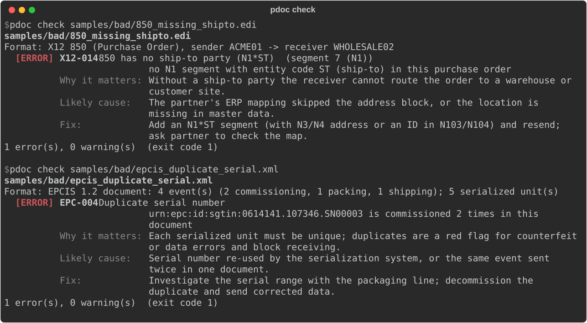
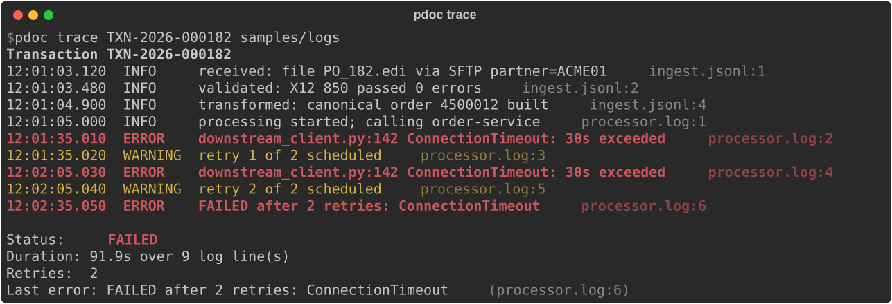
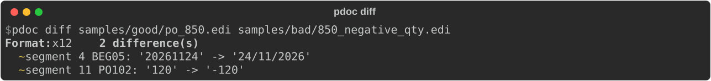

# Payload Doctor

**Explains why a B2B file failed, in plain English.**

Payload Doctor is a command-line tool for support and integration engineers. Give it an X12, EDIFACT, GS1 EPCIS 1.2 XML or CSV file, and it reports what is wrong, why it matters to the receiver, the likely cause, and the fix. It also follows one transaction through log files, compares two payloads, and checks AS2 certificates and MDN receipts.



## Why I built it

My other project, ShopPilot, serves textile manufacturers and wholesalers who exchange purchase orders, challans and e-way bills by hand. I wanted to learn how larger companies exchange these documents automatically, and how support teams work out what went wrong when an exchange fails. A parser error such as `segment 7: unexpected N1` is not something you can send a customer. Payload Doctor turns it into an answer you can send.

## Install

```bash
pip install payload-doctor          # once published
# or, from this repository:
pip install -e ".[dev]"
```

Requires Python 3.10+. The package installs a `pdoc` command.

## Commands

| Command | What it does |
| --- | --- |
| `pdoc check FILE_OR_DIR...` | Detects the format of each file and runs every rule for it |
| `pdoc check --json FILE` | Same, as JSON for scripts and pipelines |
| `pdoc trace TXN_ID LOG_DIR...` | Builds one transaction's timeline from JSON-lines and plain-text logs |
| `pdoc diff GOOD BAD` | Shows differences at segment/element (EDI), XML path or CSV cell level |
| `pdoc as2 CERT.pem [--mdn FILE]` | Checks certificate expiry, key size and signature; reads an MDN receipt |
| `pdoc rules [--format x12] [--markdown]` | Lists the rule catalogue |

**Exit codes:** `0` = clean, `1` = at least one error, `2` = warnings only, `3` = usage problem. They work directly in Bash, cron and CI.

### Trace a transaction across logs



### Compare a working file with a failing one



## What it checks

There are 70 rules across 7 groups. The full list is in [docs/rules.md](docs/rules.md), and each rule there includes why it matters, the likely cause and the fix.

| Format | Examples of what is caught |
| --- | --- |
| **X12** (850, 856, 997 + envelopes) | ISA/IEA, GS/GE and ST/SE control-number and count mismatches; truncated files; test-flagged interchanges (ISA15 = T); wrapped files; missing ship-to; bad quantities and dates; broken 856 HL hierarchy; rejected 997s |
| **EDIFACT** (ORDERS, DESADV, CONTRL) | UNB/UNZ and UNH/UNT mismatches; missing delivery party; missing despatch date; bad QTY; rejected CONTRL reports; `?` release-character handling |
| **EPCIS 1.2 XML** (pharma serialization) | Malformed XML; wrong namespace; missing eventTime / offset / action; malformed SGTIN or SSCC; duplicate serial numbers; aggregated units never commissioned; missing lot or expiry; expired product; shipping without source/destination owning party; future-dated events |
| **CSV** | Header problems; shifted columns; empty required values; non-ISO dates; GTIN check digits; non-numeric quantities; semicolon delimiters; duplicate rows |
| **AS2** | Expired or soon-expiring certificates; weak keys; SHA-1; not-yet-valid certificates; failed MDN dispositions |
| **General** | Byte-order marks, empty files, invalid UTF-8, unknown formats |

### Optional: official XSD validation

Put the GS1 EPCIS 1.2 schema files (`EPCglobal-epcis-1_2.xsd` and the files it imports) in `schemas/epcis/`, or set `PDOC_SCHEMA_DIR`, or pass `--schemas DIR`. Payload Doctor then also validates against the schema (rule XML-002). The schemas are published by GS1 and are not bundled here.

## Run it from cron

`scripts/pdoc-batch.sh` checks every file in an inbox folder, prints one log line per file, and can move failures to a quarantine folder:

```bash
*/15 * * * * /opt/payload-doctor/scripts/pdoc-batch.sh /data/inbox /data/quarantine >> /var/log/pdoc-batch.log 2>&1
```

```text
2026-11-24T07:31:10Z FAIL  inbox/850_missing_shipto.edi errors=1 warnings=0 rules=X12-014
2026-11-24T07:31:10Z WARN  inbox/850_test_flag_wrapped.edi warnings=2 rules=X12-009,X12-012
```

## Use it as a library

```python
from pdoc import check_bytes

result = check_bytes(payload_bytes, name="PO_182.edi")
if result.errors:
    for f in result.findings:
        print(f.rule.id, f.message, f.rule.fix)
```

[IntegrX](https://github.com/hrushikapendharkar4241-droid/integrx) uses Payload Doctor this way, as its validation and failure-classification engine.

## Sample library

`samples/` contains synthetic files: 7 good files and 19 bad ones, each built to trigger specific rules. There are also logs for `trace`, and certificates and MDNs for `as2`. All company names, GLNs, GTINs and serial numbers are invented. The GS1 documentation prefix 0614141 is used. Regenerate the samples with:

```bash
python scripts/make_samples.py     # certificates are dated relative to today
python scripts/render_demo.py      # README screenshots
pdoc rules --markdown > docs/rules.md
```

## Development

```bash
pip install -e ".[dev]"
pytest --cov=pdoc          # 78 tests, about 86% coverage
```

Project layout:

```text
src/pdoc/
  cli.py          commands
  engine.py       format detection + check pipeline
  parsers/        x12.py, edifact.py (own tokenizers)
  rules/          one module per format; every rule = id, severity, why, cause, fix
  gs1.py          check digits, SGTIN/SSCC parsing
  trace.py diff.py as2check.py report.py
samples/ tests/ scripts/ docs/
```

## Limitations

- Business rules cover X12 850/856/997 and EDIFACT ORDERS/DESADV/CONTRL. Other transaction sets get envelope checks only.
- X12 rules follow publicly documented segment structures and common practice. They are not a substitute for a licensed X12 implementation guide or a partner's specific guidelines.
- EPCIS 2.0 (JSON-LD) is not supported yet.
- XML parsing never resolves external entities or touches the network. This protects against XXE in partner files, and a test proves it.

## License

MIT
